# Somatic OS アプリ構想（デザイン）

研究レポートと実践ガイドをもとにした、セルフケアアプリの構想です。コンセプト、体験設計、操作できるプロトタイプ、17の画面でできています。

> 画面に出てくる数字は、すべてサンプルです。このアプリは診断や治療の代わりではありません。

## コンセプト：意味は、あとからついてくる

考え方を変える前に、からだから整える。毎朝その日のからだの状態を3つから選ぶと、アプリに出てくる量が変わります。

| モード | どんな日 | 出すもの | 出さないもの |
| --- | --- | --- | --- |
| まもる日 | 起きるのも考えるのもつらい日 | ★の項目だけ、つらいとき、相談先 | ふりかえり、目標、数やグラフ |
| ととのえる日 | 動けるけれど、からだが重い日 | 朝・日中・夜のメニュー、4週間の歩くプラン | 新しい目標、ふりかえり |
| ひろげる日 | ふだんどおり動ける日 | ととのえる日のすべて、週1のふりかえり、わかったこと | 睡眠を削る提案 |

<a href="screens/main.png">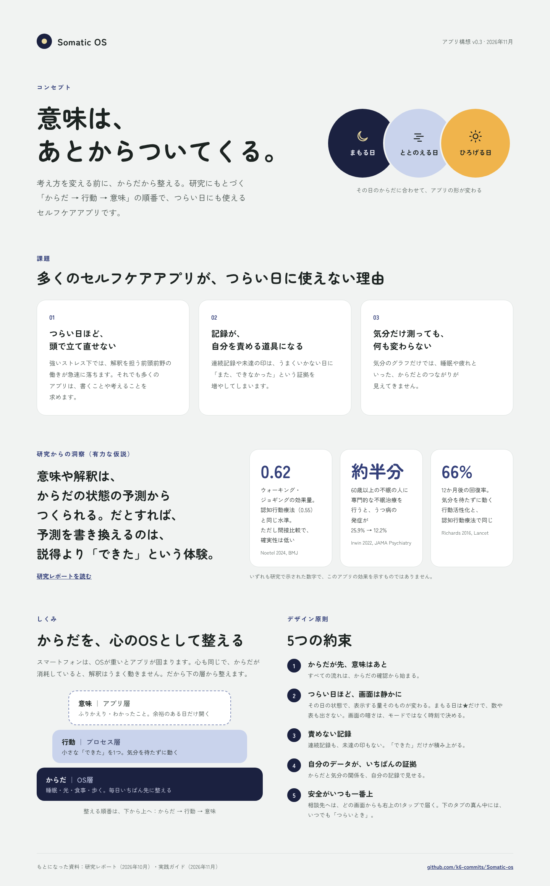</a>
<a href="screens/experience.png">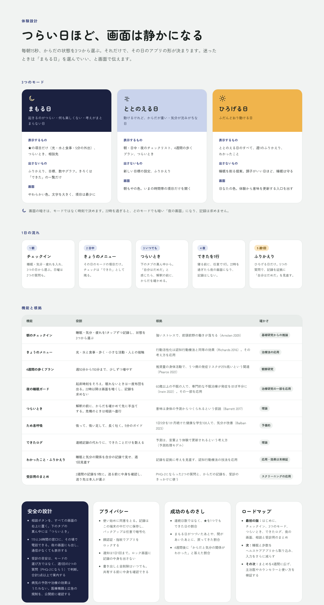</a>

## 設計のルール

- **その日のからだで、画面の量が変わる。** つらい日ほど項目を減らし、文字を大きくします。
- **画面の暗さは、モードではなく時刻で決める。** 22時を過ぎると、どのモードでも暗い「夜の画面」になり、記録は求めません。
- **数えるのは「できた」だけ。** 連続記録、未達の印、「3つ中1つ」のような分母は出しません。
- **安全がいつも一番上。** 相談ボタンを画面の右上に置き、下のタブの真ん中はいつでも「つらいとき」です。
- **受診の目安は、週1回の2つの質問で判断する。** PHQ-2にならい、合計3点以上で相談先を案内します。モードの選び方では判断しません。
- **記録はこの端末の中だけ。** 共有は、送る前に中身を確認してから。送り先は本人が選びます。

## プロトタイプ

左の画面を、アプリのように操作できます。モードと「戻る」は画面をまたいで引き継がれます。右側で「場面」（はじめて／2週間後／7日ぶり）と「時刻」（昼間／夜22時以降）を切り替えられます。

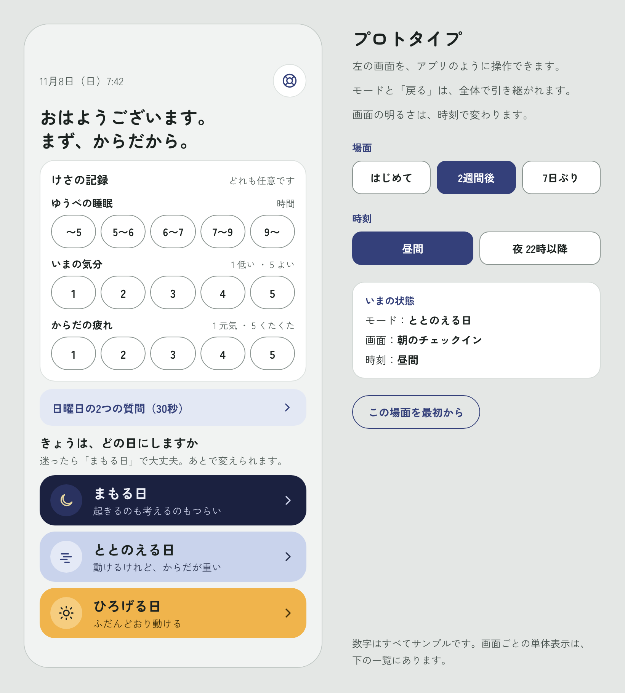

## 画面一覧

### はじめる・朝・夜

<table>
<tr>
<td align="center" width="25%">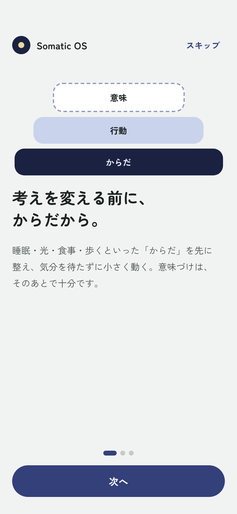 0a はじめに</td>
<td align="center" width="25%">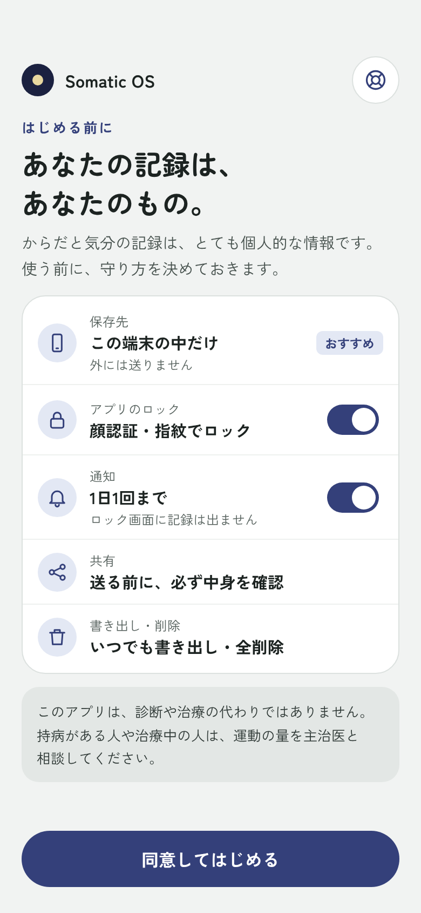 0b はじめる前に</td>
<td align="center" width="25%">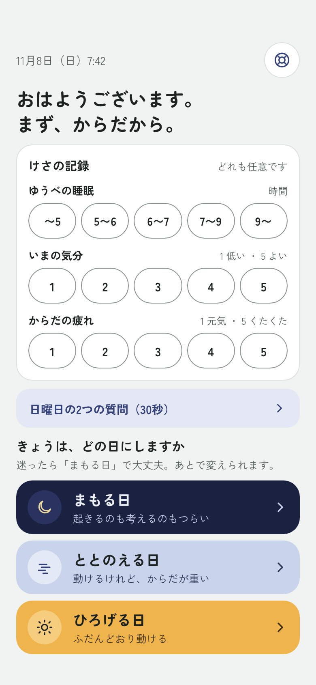 1 朝のチェックイン</td>
<td align="center" width="25%">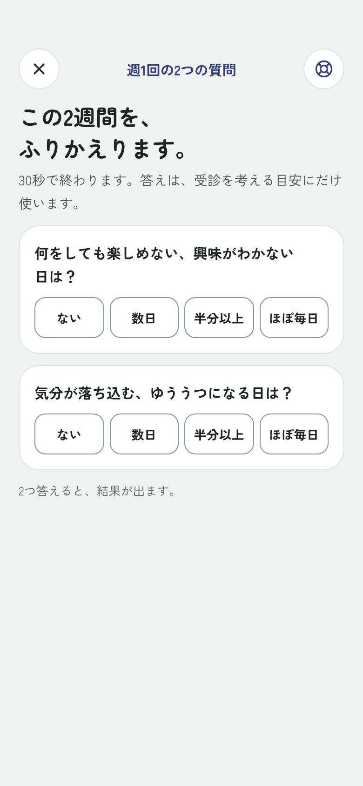 1b 日曜日の2つの質問</td>
</tr>
<tr>
<td align="center">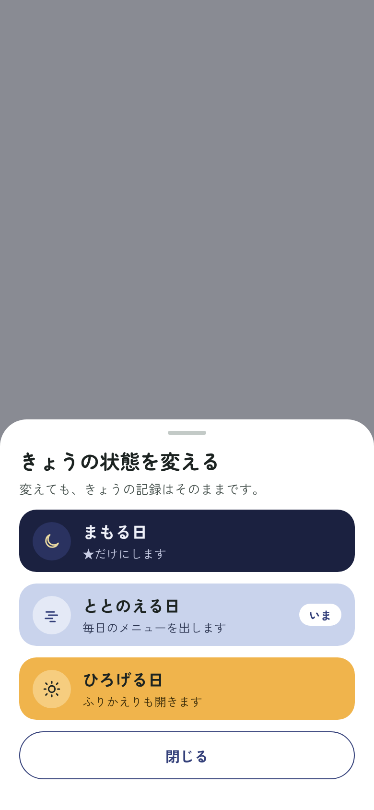 1c 状態を変える</td>
<td align="center">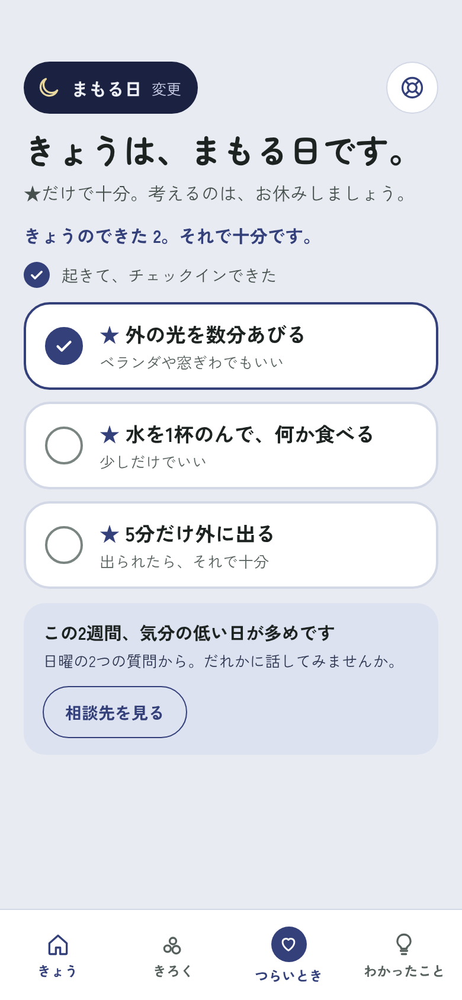 2 ホーム：まもる日</td>
<td align="center">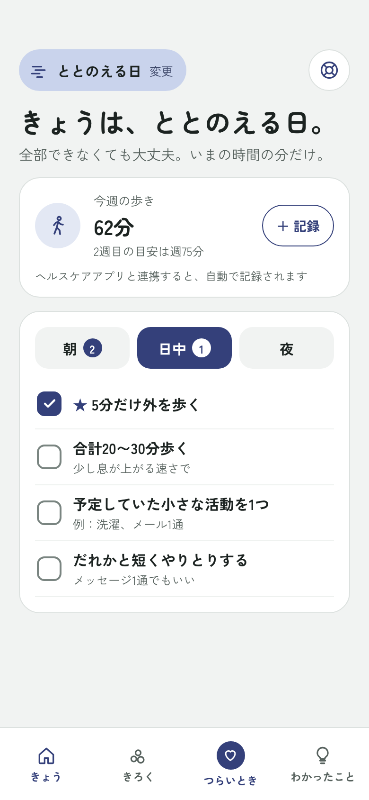 3 ホーム：ととのえる日</td>
<td align="center">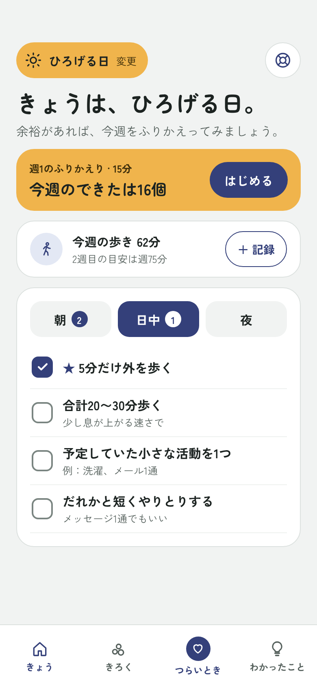 4 ホーム：ひろげる日</td>
</tr>
<tr>
<td align="center">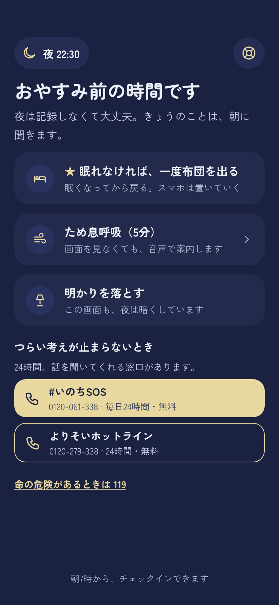 5 夜の画面</td>
<td></td><td></td><td></td>
</tr>
</table>

### いつでも・記録・相談

<table>
<tr>
<td align="center" width="25%">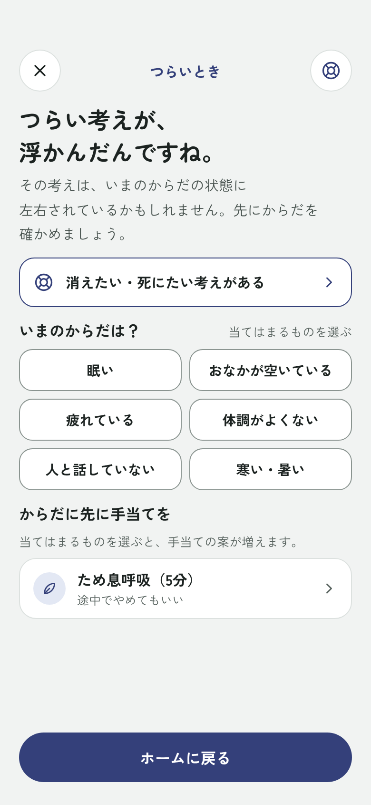 6 つらいとき</td>
<td align="center" width="25%">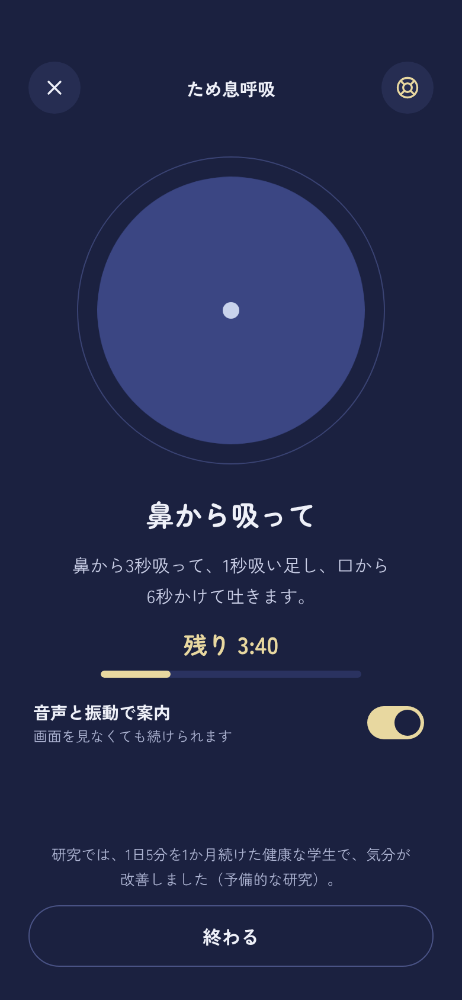 7 ため息呼吸</td>
<td align="center" width="25%">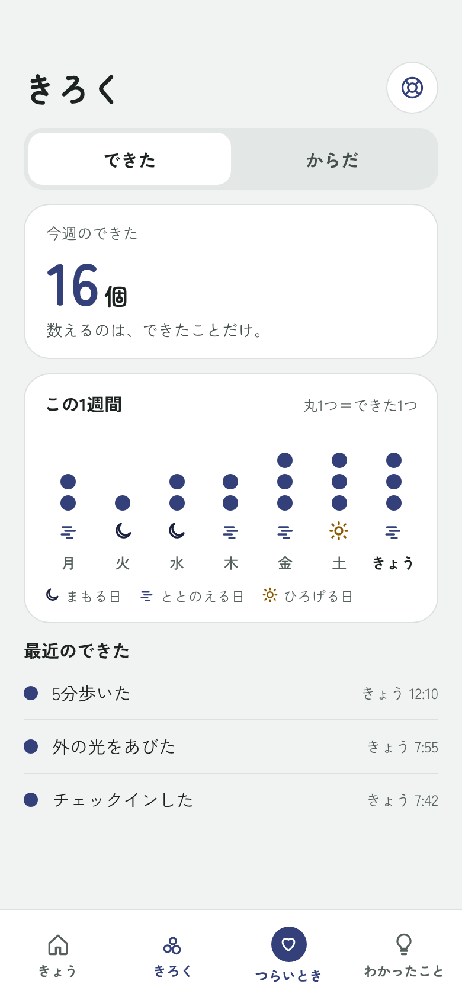 8 きろく</td>
<td align="center" width="25%">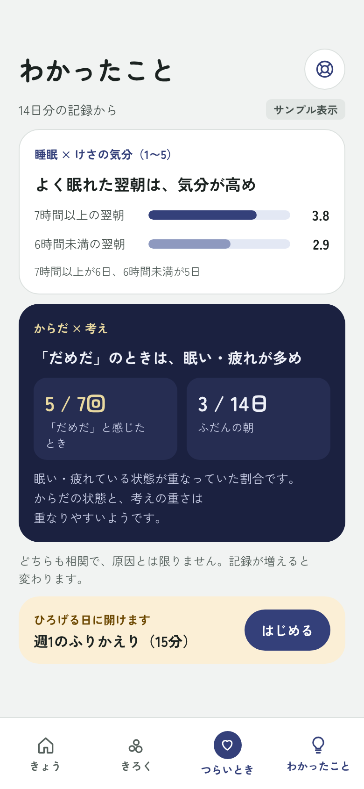 9 わかったこと</td>
</tr>
<tr>
<td align="center">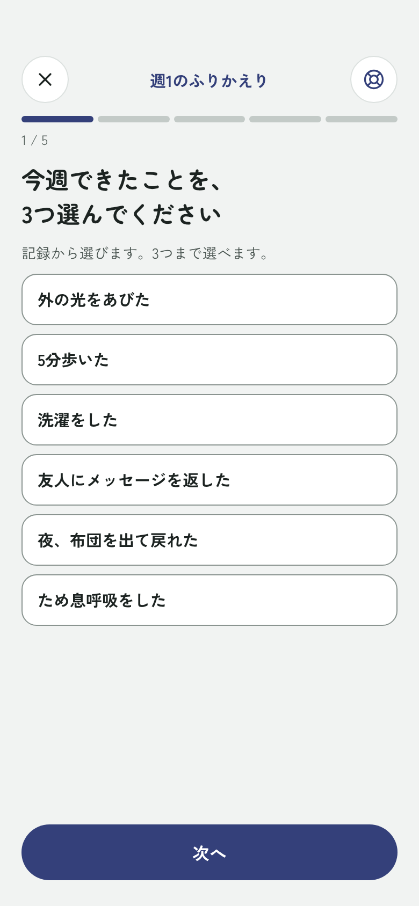 10 週1のふりかえり</td>
<td align="center">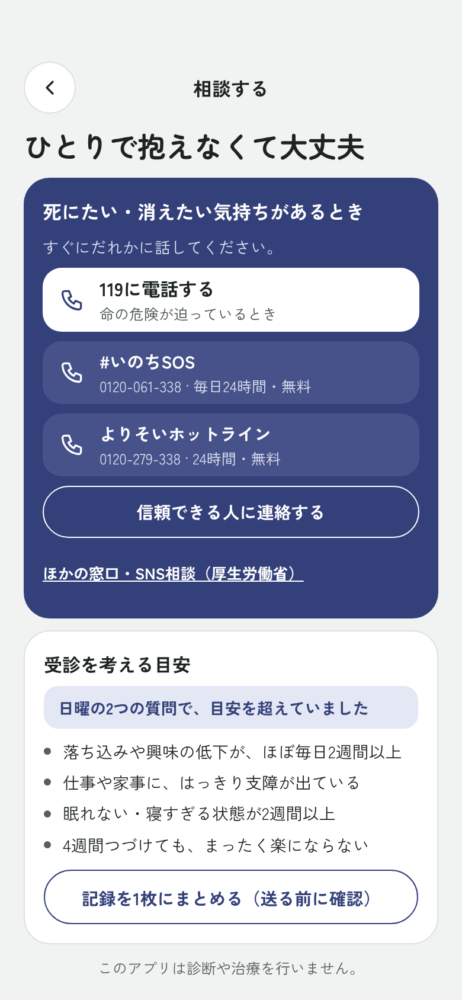 11 相談する</td>
<td align="center">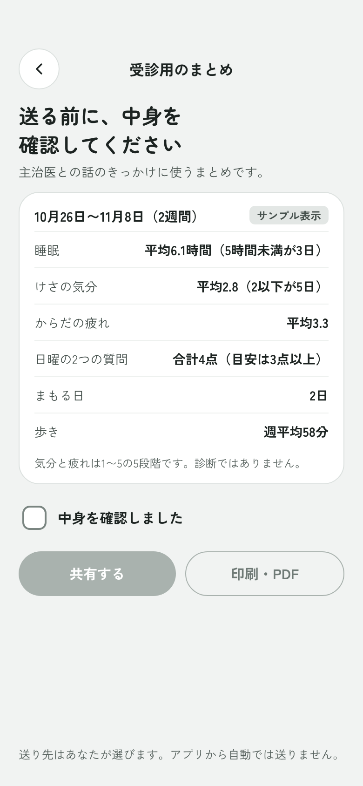 12 受診用のまとめ</td>
<td align="center">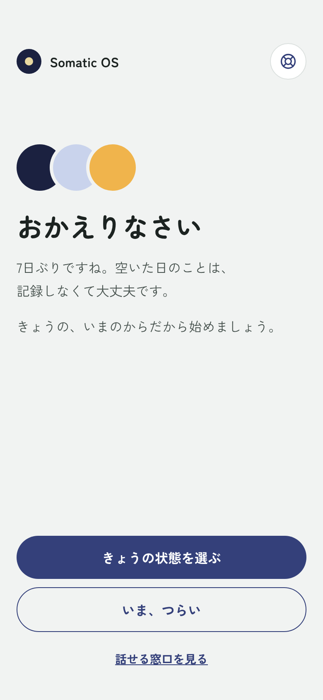 13 おかえりなさい</td>
</tr>
</table>

## ファイル

| パス | 中身 |
| --- | --- |
| `project/canvas.json` | キャンバス上のボードの配置 |
| `project/*.dc.html` | 各ボードのソース。claude.ai のデザインキャンバスの形式です |
| `screens/*.png` | 各ボードを書き出した画像 |

`.dc.html` は、デザインキャンバスの実行環境（`support.js`）の上で動く形式です。このリポジトリには実行環境を含めていないので、ブラウザで直接開いても表示されません。見た目は `screens/` の画像で確認できます。編集元のキャンバスは [claude.ai](https://claude.ai/artifact/FFpxx6xJ6P3HyGDZwejkKw) にあります（オーナーのみ閲覧できます）。

## プロトタイプの限界

- 画面どうしで状態を共有していません。ホームでチェックしても、「きろく」の数は増えません。
- 「＋ 記録」「共有する」「印刷・PDF」「信頼できる人に連絡する」は見た目だけです。
- 下のタブを押すたびに履歴が積み上がるので、「つらいとき」を閉じると直前のタブに戻ります。

## 相談窓口の情報

画面の電話番号と受付時間は、2026年11月8日に厚生労働省の[「まもろうよ こころ」](https://www.mhlw.go.jp/mamorouyokokoro/)で確認しました。窓口の情報は変わることがあるので、公開する前にもう一度確認してください。
