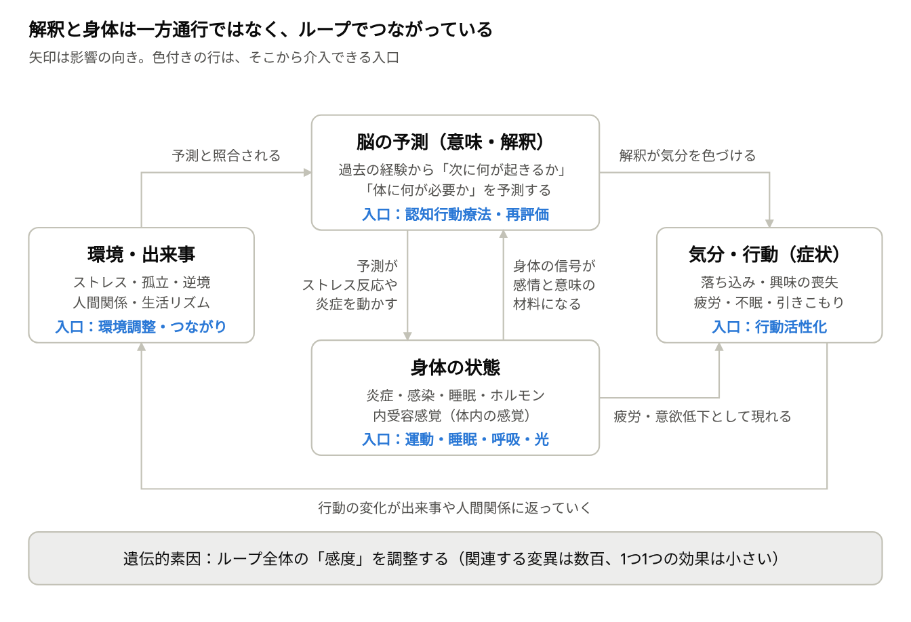
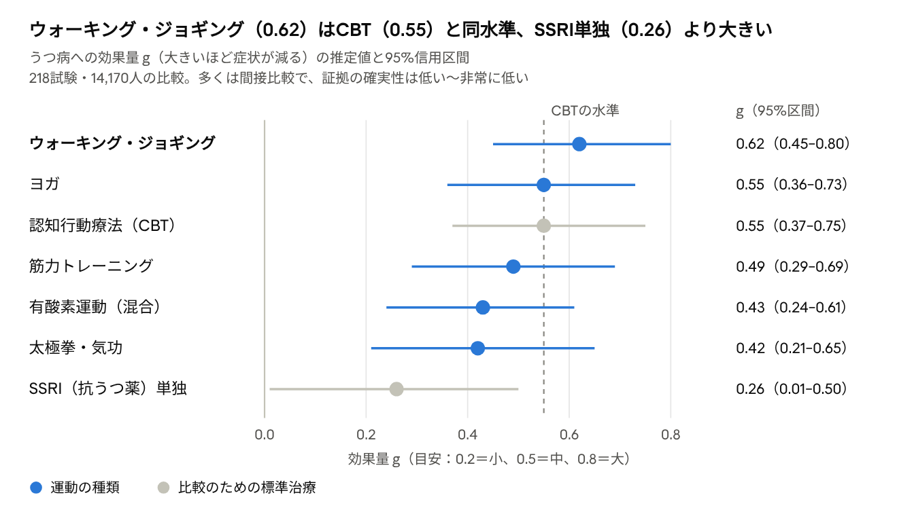

# 意味・解釈と身体：うつ病とメンタルの最新モデル

最終更新：2026-10-30

## 要約

意味・解釈と身体感覚は強く紐づいており、そのつながりは一方通行ではなく双方向です。「うつ病は遺伝子とウイルスで決まり、メンタルは関係ない」という理解は、現在の研究からは支持されません。

- **意味は身体からつくられる**：有力な理論では、脳は身体の状態（心拍、エネルギー、炎症など）を予測し、それに概念で意味を与えて感情をつくります。同じ出来事でも、疲れているときと元気なときで意味が変わるのはこのためです。
- **遺伝は約37%、残りは環境**：双子研究の遺伝率は37%です。2025年の最大規模のゲノム研究では697の関連が見つかりましたが、個々の効果は小さく、一般的な変異で説明できるのは8.4%です。
- **ウイルス説はまだ仮説**：ヘルペスウイルス6（SITH-1）の研究は日本の1グループの報告で、独立した追試はありません。しかもこの説自体が「疲労やストレスでウイルスが再活性化する」という心身の連動を前提にしています。
- **「解釈で何とかする」には限界がある**：強いストレス下では、解釈を担う前頭前野の働きが急速に落ちます。つらいときほど考え方だけで立て直すのが難しいのは、意志の問題ではなく脳の仕組みです。
- **身体からの入口は根拠が厚い**：運動の効果は認知行動療法と同程度と報告され、高齢者では不眠の治療がうつ病の発症をほぼ半分にしました。ただし運動にも達成感など「意味の変化」の経路が含まれ、身体と解釈は最後まで分けられません。

更新すべき考え方は、「心か体か」ではなく「身体と行動を入口にして、意味を後から更新する」という順番です。

## 問いの整理：2つの問いと3つの立場

ご質問は次の2つに分けられます。

1. 意味や解釈（出来事を頭の中でどう受け取るか）は、身体の感覚と紐づいているのか。
2. 「うつ病は遺伝子やウイルスの問題で、メンタル（考え方）はあまり関係ない」は本当か。

この2つの背景には、心と体の関係についての3つの立場があります。

| 立場 | 主な考え方 | 代表例 | 本レポートでの評価 |
| --- | --- | --- | --- |
| 認知中心モデル | 出来事そのものより「解釈」が気分を決める | ベックの認知モデル、エリスのABC理論（1960〜70年代） | 一部は正しいが、解釈は身体から独立していない |
| 生物学中心モデル | うつ病は脳内物質・遺伝子・感染などによる病気 | セロトニン不足説（1960年代〜）、「脳の病気」という説明 | 生物的要因は実在するが、単一の原因ではない |
| 身体化・統合モデル | 脳は身体の状態を予測し、その予測から感情と意味をつくる。遺伝・身体・解釈・環境が互いに影響し合う | 予測処理・内受容理論、炎症モデル、ネットワーク理論（2010年代〜） | 近年の研究が向かっている方向 |

以下では、2026年10月時点の研究をもとに、3つ目の統合モデルが何を示しているか、そして日常に何を意味するかを整理します。

## 「遺伝子とウイルスで決まる」説の検証

遺伝も感染・免疫も実在するリスク要因ですが、どちらも「メンタルは関係ない」ことは示していません。ストレスや逆境の影響は、遺伝と同じかそれ以上に大きいと示されています。

| 要因 | 主な知見 | 何を意味するか |
| --- | --- | --- |
| 遺伝（双子研究） | 遺伝率37%、個人に固有の環境63%（[Sullivan 2000](https://pubmed.ncbi.nlm.nih.gov/11007705/)） | 遺伝は「なりやすさ」の一部。6割以上は環境側 |
| 遺伝（最大規模のゲノム研究） | 患者68万8808人・対照436万人で697の関連を発見。一般的な変異で説明できるのは8.4%、個人の遺伝的リスク得点では最大5.8%（[PGC 2025, Cell](https://pmc.ncbi.nlm.nih.gov/articles/PMC11829167/)） | 「うつ病遺伝子」はなく、効果の小さな変異が数百ある |
| 候補遺伝子説 | セロトニン輸送体遺伝子など有名な18の「うつ病遺伝子」は、最大44万人の検証で関連が見られず（[Border 2019](https://pubmed.ncbi.nlm.nih.gov/30845820/)、[Culverhouse 2018](https://pmc.ncbi.nlm.nih.gov/articles/PMC5628077/)） | 2000年代の「この遺伝子×ストレス」説は支持されない |
| セロトニン不足説 | 「セロトニン低下が原因」という一貫した証拠はない（[Moncrieff 2022](https://pmc.ncbi.nlm.nih.gov/articles/PMC10618090/)）。反論では、セロトニン系はなりやすさに関わるとされる（[Jauhar 2023](https://pmc.ncbi.nlm.nih.gov/articles/PMC10618084/)） | 「脳内物質の不足」という単純な説明は古い |
| ヘルペスウイルス6（SITH-1） | SITH-1抗体の陽性率は患者84人で79.8%、対照82人で24.4%、オッズ比12.2（[Kobayashi 2020, iScience](https://pmc.ncbi.nlm.nih.gov/articles/PMC7298549/)） | 興味深いが、独立した追試はまだない |
| 重い感染症・自己免疫疾患 | 感染症での入院歴で気分障害のリスクが62%増、自己免疫疾患で45%増（[Benros 2013](https://pubmed.ncbi.nlm.nih.gov/23760347/)、デンマーク356万人） | 身体の炎症・免疫は確かにリスクを上げる |
| 子ども時代の虐待 | 成人期のうつ病の可能性が2.66〜3.73倍（[Nelson 2017](https://pubmed.ncbi.nlm.nih.gov/27908895/)、184研究） | 経験は長期にわたって影響する |
| 強いストレス出来事 | 出来事のあった月の発症オッズ比5.64。その関連の約3分の2は因果的（[Kendler 1999](https://pubmed.ncbi.nlm.nih.gov/10360120/)、女性の双子） | 出来事は遺伝とは別に発症の引き金になる |

### 「ウイルスが原因」という情報について

ご覧になった情報は、おそらく慈恵医大の近藤一博教授らの研究です。2024年2月の[プレスリリース](https://www.jikei.ac.jp/news/pdf/press_release_20240213.pdf)や[現代ビジネスの記事](https://gendai.media/articles/-/125101)、2026年5月の[財務省広報誌への寄稿](https://www.mof.go.jp/public_relations/finance/202605/202605b.html)などで紹介されています。注意点は3つです。

1. **独立した追試がない**：2021〜2026年の続報はすべて同じ研究グループによるものです。タイの独立した研究（[Srabuakam 2026](https://pmc.ncbi.nlm.nih.gov/articles/PMC13307731/)、患者52人）では、唾液中のHHV-6とうつ病に関連は見られませんでした（SITH-1そのものは測定していません）。またプレスリリースは「遺伝率は染色体の伝搬では説明がつかない」としていますが、これは697の遺伝的関連を報告した2025年の大規模研究と食い違います。
2. **仕組みの証拠はマウス実験**：SITH-1を人工的に発現させたマウスの結果で、人での自然な感染経路は直接は検証されていません。著者は関連特許と企業の株式を保有していると開示しています。
3. **心と身体を分けていない**：この説は「疲労やストレスでウイルスが再活性化し、脳に炎症が起き、ストレスホルモン系が動く」という流れです。ストレスと身体が連動するモデルであり、「メンタルは関係ない」を示すものではありません。

### 「心の弱さではない」と「心理は関係ない」は別の話

Lancet誌と世界精神医学会の合同委員会（[Herrman 2022](https://pubmed.ncbi.nlm.nih.gov/35180424/)）は、うつ病は「本人のせいでも、心の弱さの表れでもない」と明言しています。同時に、身近な逆境が引き金となり、遺伝・環境・社会・発達の要因と相互作用するとも述べています。つまり「意志や性格の問題ではない」ことと、「心理的要因が関係しない」ことは別です。心理的要因は今も主要な要因の一つです。

## 最新モデル①：意味は身体の予測からつくられる

「意味や解釈は感覚と紐づいているか」への最新の答えは、「はい、解釈はそもそも身体感覚を材料につくられる」です。代表的なのが、予測処理（能動的推論）と内受容感覚の理論です（[Seth & Friston 2016](https://pubmed.ncbi.nlm.nih.gov/28080966/)、[Khalsa 2018](https://pubmed.ncbi.nlm.nih.gov/29884281/)）。

### 仕組み

1. **脳の本業は身体の管理**：脳は体が次に必要とするエネルギーを先回りして予測し、調整しています。これをアロスタシスと呼びます（[Barrett 2016](https://pmc.ncbi.nlm.nih.gov/articles/PMC5062100/)）。
2. **体内の信号と照合する**：心拍、呼吸、内臓、炎症などの体内の感覚（内受容感覚）が、その予測と照らし合わされます。
3. **概念で意味を与える**：脳は概念を使ってこの感覚を分類し、意味を与えます。それが「感情」として体験されます（[Barrett 2017](https://pmc.ncbi.nlm.nih.gov/articles/PMC5390700/)）。

例えば同じ動悸でも、試験の前なら「不安」、好きな人の前なら「ときめき」と意味づけられます。逆に、睡眠不足で体が重い日は、同じ一言が「否定された」と感じられやすくなります。Barrettは「意味が行動を引き起こすのではなく、行動の結果として意味が生じる」とまで書いています。

### うつ病はこのモデルでどう見えるか

[Barrett 2016](https://pmc.ncbi.nlm.nih.gov/articles/PMC5062100/)は、うつ病を「アロスタシス（エネルギー調整）の障害」という仮説で説明します。気分、運動、自律神経、免疫、代謝、概日リズムの乱れは、すべて「非効率なエネルギー調整」を指すという考えです。脳は「エネルギーが足りない」と予測し続け、疲労感として体にブレーキをかけます。その予測は外の状況が変わっても更新されにくくなります（論文の表現では「閉じ込められた脳」）。

この見方では、「どうせ無理だ」という解釈は性格の問題ではありません。エネルギー不足を予測している脳にとっては、筋の通った「最善の推測」なのです。そのため、言葉で解釈だけを書き換えても、身体からの信号が同じままだと元に戻りやすいと考えられます。

### 根拠の強さ

- **理論の位置づけ**：影響力は大きいものの、Barrett 2016は新しいデータを含まない仮説論文です。正しいと確定したわけではありません。
- **「感じ取る力」ではなく「どう感じているか」**：心拍を数える正確さなど客観的な内受容の精度は、うつとの関連がほぼないか小さいものです（[Desmedt 2022](https://doi.org/10.1525/collabra.33271)で133研究、[Tan 2026](https://pubmed.ncbi.nlm.nih.gov/41894924/)でr=−0.10）。一方、自分の体の感覚をどう受け止めているかの自己報告は、うつと一貫して関連します（[Jenkinson 2026](https://pubmed.ncbi.nlm.nih.gov/41856002/)、49研究・2万1755人）。つまり問題は身体の信号そのものより、その「意味づけ」にありそうです。
- **単純な「体のハック」の効果は小さい**：笑顔をつくると幸福感が増えるという顔面フィードバック効果は存在しますが、「有意だが小さい」ものです（[Coles 2019](https://pubmed.ncbi.nlm.nih.gov/30973236/)、[Many Smiles 2022](https://pubmed.ncbi.nlm.nih.gov/36266452/)、参加者3,878人）。身体は感情に影響しますが、一瞬の姿勢や表情でうつ病が変わるわけではありません。

## 最新モデル②：炎症・腸・ストレスを通じた心と体の双方向性

「心の問題」と「体の問題」は、炎症とストレス反応を介して同じ回路でつながっています。心理的ストレスは体に炎症を起こし、体の炎症は気分や意欲を下げます。

### 炎症：うつ病患者の約4人に1人

- **低レベルの炎症がある人は少なくない**：うつ病患者の27%は炎症マーカー（CRP）が3 mg/Lを超え、1 mg/L超も含めると58%でした（[Osimo 2019](https://pubmed.ncbi.nlm.nih.gov/31258105/)、1万3541人）。
- **炎症物質そのものでうつが起きる**：C型肝炎の治療でインターフェロン（炎症を起こす物質）を投与された人の約4人に1人が、48週までにうつ病エピソードを発症しました（[Udina 2012](https://pubmed.ncbi.nlm.nih.gov/22967776/)）。
- **因果の向きは部分的に支持**：遺伝子を使った因果推論（メンデルランダム化法）では、炎症性物質IL-6の経路がうつ病のリスクを上げる方向が示されています（[Khandaker 2020とその訂正](https://pmc.ncbi.nlm.nih.gov/articles/PMC8505250/)、[Ye 2021](https://pubmed.ncbi.nlm.nih.gov/34505025/)）。ただしCRPの結果は研究によって向きが一致せず、「証明された」とは言えません。
- **抗炎症薬は研究段階**：36試験のメタ分析では抗うつ薬への上乗せで効果がありましたが、すべての試験がバイアスのリスクが高いと評価されています（[Köhler-Forsberg 2019](https://pubmed.ncbi.nlm.nih.gov/30834514/)）。

### ストレスが炎症になり、炎症が「うつらしさ」になる

[Slavich & Irwin 2014](https://pubmed.ncbi.nlm.nih.gov/24417575/)の「社会的シグナル伝達理論」は、この双方向性を一つの回路として説明します。拒絶や孤立などの社会的な脅威が炎症反応を高め、炎症性物質が悲しい気分、快楽の喪失、疲労、引きこもりを引き起こします。重要なのは、この反応が「象徴的な脅威や想像上の脅威」でも起きるという点です。つまり「どう解釈したか」が、そのまま体の炎症に反映されます。

さらに、軽いストレスでも、自分でコントロールできないと前頭前野（解釈や計画を担う部位）の能力は急速に落ちます。長期のストレスでは神経細胞の形そのものが変わります（[Arnsten 2009](https://pubmed.ncbi.nlm.nih.gov/19455173/)）。「つらいときほど前向きに解釈できない」のは、このためです。

### 腸と脳：関連はあるが、治療は未確立

- 1,054人の調査で、うつの人では腸内細菌のコプロコッカス属とディアリスター属が少なく、抗うつ薬の影響を補正しても同じでした（[Valles-Colomer 2019](https://pubmed.ncbi.nlm.nih.gov/30718848/)）。オランダの別の集団でも13種類の細菌が関連しました（[Radjabzadeh 2022](https://pubmed.ncbi.nlm.nih.gov/36473852/)）。ただしいずれも横断研究で、因果は不明です。
- プロバイオティクスの効果は、企業の資金による研究を除くと有意でなくなりました（[Liu 2026](https://pmc.ncbi.nlm.nih.gov/articles/PMC12819584/)）。27試験の別の分析でも、12週未満では効果が見られませんでした（[Anjum 2026](https://pubmed.ncbi.nlm.nih.gov/42495752/)）。

## 最新モデル③：原因は「1つ」ではなく「ループ」

現在の統合的な見方では、うつ病は単一の原因で起きる病気ではありません。遺伝・身体・解釈・環境が互いを強め合うループとして理解されます。

*図1：うつ病の統合モデル · 4つの要素と介入の入口*

どの箱からでもループに入れます。考え方（上）だけでなく、身体（下）や行動（右）からも、同じループを緩められます。

- **症状同士が原因になり合う**：ネットワーク理論（[Borsboom 2017](https://pubmed.ncbi.nlm.nih.gov/28127906/)）では、症状は生物・心理・社会の無数の仕組みで因果的につながっています。例えば「眠れない→疲れる→集中できない→自分を責める→さらに眠れない」です。つながりが強いと、きっかけが消えてもループが自分で回り続けます。
- **「うつ病」は1つの姿ではない**：米国の患者3,703人を調べると、症状の組み合わせは1,030通りありました。最も多いパターンでも全体の1.8%です（[Fried & Nesse 2015](https://pubmed.ncbi.nlm.nih.gov/25451401/)）。人によってループの中心が異なるため、「原因は遺伝子」「原因は考え方」のように1つに絞る議論はかみ合いません。
- **薬も「受け取り方」を変えて効く**：抗うつ薬は、気分が改善するより前の非常に早い段階で、ポジティブな情報を処理する割合を増やします（[Harmer 2017](https://pmc.ncbi.nlm.nih.gov/articles/PMC5410405/)）。気分が遅れて改善するのは、新しい受け取り方で感情の結びつきを学び直す時間が必要なためと考えられています（[Harmer & Cowen 2013](https://pubmed.ncbi.nlm.nih.gov/23440467/)）。生物学的な治療でさえ、意味づけの変化を経由していることになります。

## 身体からのアプローチ：運動と睡眠の根拠が最も厚い

身体から整えるアプローチの中では、運動と睡眠の改善が最も根拠が厚く、運動の効果は心理療法と同程度と報告されています。一方、呼吸法やソマティック療法は方向性は有望でも、研究の質はまだ低い段階です。

*図2：出典 Noetel et al. 2024, BMJ · 7つの治療法 · 論文の負の値を正に反転して表示*

点線より右にある治療は、CBTと同等以上の推定値です。ただし区間は大きく重なっており、運動がCBTより優れているとまでは言えません。

| アプローチ | 主な研究 | 結果 | 根拠の強さ |
| --- | --- | --- | --- |
| 不眠の治療（CBT-I） | [Irwin 2022, JAMA Psychiatry](https://pmc.ncbi.nlm.nih.gov/articles/PMC8733847/)：60歳以上の不眠291人 | 3年間のうつ病発症 12.2% vs 25.9%（ハザード比0.51） | 無作為化比較試験 |
| 光療法（季節性でないうつ） | [Menegaz de Almeida 2025, JAMA Psychiatry](https://pubmed.ncbi.nlm.nih.gov/39356500/)：11試験・858人 | 寛解 40.7% vs 23.5%（既存治療への上乗せ） | 中程度 |
| 身体活動（予防） | [Pearce 2022, JAMA Psychiatry](https://pubmed.ncbi.nlm.nih.gov/35416941/)：15研究・約19万人 | 推奨量（早歩き週2.5時間相当）で発症リスク25%低下、その半分でも18%低下 | 観察研究（因果は未確定） |
| ランニング vs 抗うつ薬 | [Verhoeven 2023, J Affect Disord](https://pubmed.ncbi.nlm.nih.gov/36828150/)：141人 | 16週の寛解率 43.3% vs 44.8%で差なし。ランニング群は体重・血圧・心拍変動も改善 | 小規模、無作為化は一部のみ |
| 食事改善（地中海食型） | [Jacka 2017, BMC Med（SMILES）](https://pubmed.ncbi.nlm.nih.gov/28137247/)：67人 | 12週の寛解 32.3% vs 8.0% | 小規模な1試験 |
| 呼吸法 | [Fincham 2023, Sci Rep](https://pmc.ncbi.nlm.nih.gov/articles/PMC9828383/)：うつ症状は18試験 | 効果量 g=0.40（小〜中） | 低い（バイアスの少ない試験がない） |
| 身体心理療法全般 | [Rosendahl 2021, Front Psychiatry](https://pmc.ncbi.nlm.nih.gov/articles/PMC8458738/)：18試験 | 精神症状全体で g=0.56 | 低〜中（うつ病単独の結果はない） |
| ソマティック・エクスペリエンシング | [Brom 2017, J Trauma Stress](https://pubmed.ncbi.nlm.nih.gov/28585761/)、[Kuhfuß 2021](https://pmc.ncbi.nlm.nih.gov/articles/PMC8276649/) | PTSD患者63人でうつ症状も改善（d=0.70〜1.08、待機群との比較） | 予備的（うつ病を対象とした試験はほぼない） |

不眠そのものがうつ病の発症リスクを約2倍にします（[Baglioni 2011](https://pubmed.ncbi.nlm.nih.gov/21300408/)の21研究のメタ分析でオッズ比2.1〜2.6）。睡眠を整えることは、症状対策であると同時に予防でもあります。

読み取れることは3つです。

- 「体を動かす」は気休めではなく、心理療法や薬と並ぶ選択肢になりつつあります。強度が高いほど効果が大きい傾向もあります。
- 運動の効果は「体だけ」の経路ではありません。睡眠、炎症、達成感、人との接触など、身体と意味の両方の経路が重なっていると考えられています。
- ソマティック心理学の「心は身体と切り離せない」という方向性は研究と合っています。ただし個々の技法の効果検証はまだ途上です。例えば1日5分の「ため息呼吸」で気分が上がった研究（[Balban 2023](https://pmc.ncbi.nlm.nih.gov/articles/PMC9873947/)）は、健康な学生108人が対象です。

## 解釈・意味からのアプローチ：効くが、入口にすると難しいことがある

解釈を扱う認知行動療法（CBT）の効果は確かで、古い方法になったわけではありません。ただし中身を見ると、「考え方を変える」部分より「行動を変える」部分が大きく効いている可能性が見えてきました。

| 研究 | 対象 | 結果 |
| --- | --- | --- |
| [Cuijpers 2023, World Psychiatry](https://pmc.ncbi.nlm.nih.gov/articles/PMC9840507/) | CBT、409試験・5万2702人 | 対照群との効果量 g=0.79（出版バイアス補正後0.47）。反応率42% vs 19%。短期では薬と同等で、6〜12か月後はCBTが上回る |
| [Richards 2016, Lancet（COBRA）](https://pmc.ncbi.nlm.nih.gov/articles/PMC5007415/) | 行動活性化 vs CBT、440人 | 12か月後の回復率はどちらも66%。行動活性化は経験の浅いスタッフでも実施でき、費用は21%低い |
| [Dimidjian 2006, J Consult Clin Psychol](https://pubmed.ncbi.nlm.nih.gov/16881773/) | 行動活性化・認知療法・薬、241人 | 重めのうつでは、行動活性化が薬と同等で、認知療法を上回った（1試験の結果） |

行動活性化は、考え方を検討する工程を省き、「気分に関係なく予定した活動をする」ことに集中する方法です。それでもCBTと同じ効果が出たことは、「まず動くこと」自体に大きな力があることを示しています。

### 「解釈で整えるのが難しい」ことの説明

- **脳の状態**：強いストレス下では、解釈を担う前頭前野の働きそのものが落ちています（前章のArnsten 2009）。
- **予測は言葉より証拠で更新される**：予測処理モデルでは、脳の予測は「予測と実際のズレ」によって書き換えられます。「自分はだめだ」という予測は、言い聞かせよりも「実際に歩けた」「人と話せた」という体験の方が更新しやすいと考えられます。
- **意味は出口でもある**：だからといって解釈が無意味なのではありません。身体や行動で余裕ができた後に、その体験にどう意味づけするかが、再発しにくさに関わります。CBTの効果が薬より長続きするのは、そのひとつの表れと考えられます。

## 考え方のアップデート：従来モデルと最新モデル

最大の更新点は、「心か体か」という二択から、「どこから入ればループを緩められるか」という問いへの移行です。

| テーマ | 従来の考え方 | 更新された考え方 |
| --- | --- | --- |
| 心と体 | 心（解釈）と体は別物。気分は考え方で決まる | 解釈は身体の予測からつくられ、解釈は炎症やストレス反応を通じて体を変える。双方向 |
| うつ病の原因 | セロトニン不足、または心の弱さ | 単一の原因はない。遺伝・身体・解釈・環境が強め合うループ |
| 遺伝 | 「うつ病遺伝子」がある | 効果の小さな変異が数百。遺伝率は約37%で、残りは環境 |
| ウイルス・炎症 | 心の病気に感染は関係ない | 感染・炎症はリスク要因の一つ（患者の約4人に1人に炎症）。ただしウイルス単独原因説は未確立 |
| 「うつ病」の姿 | 1つの病気 | 症状の組み合わせは1,030通り。人によってループの中心が違う |
| 運動 | 気分転換、補助的なもの | 心理療法と同程度の効果を持つ選択肢 |
| 整える順番 | まず考え方を変える | 重いときは身体と行動から入り、余裕ができてから意味づけを更新する |
| 本人の責任 | 前向きになれないのは努力不足 | 強いストレス下では解釈の機能そのものが落ちる。努力不足ではない |

## 実践への示唆：「体→行動→意味」の順に整える

研究から導ける実践の順番は、身体の土台を整え、気分を待たずに動き、意味づけは後から更新する、です。

1. **睡眠を最優先にする**：不眠はうつ病のリスクを約2倍にします。起床時刻をそろえ、不眠が続くなら「不眠の認知行動療法（CBT-I）」を検討します。
2. **続けられる運動を選ぶ**：早歩き週2.5時間相当で発症リスクが25%低く、その半分でも18%低いという関連があります。ウォーキング、ジョギング、ヨガ、筋トレのどれでも効果が報告されています。強度は無理のない範囲で上げます。
3. **気分を待たずに予定どおり動く**：行動活性化の考え方です。小さな活動を予定に入れ、終わったら「できた」と記録します。この記録が、脳の予測を書き換える「証拠」になります。
4. **解釈の前に体を確かめる**：「自分はだめだ」と感じたら、まず「疲れているか、眠いか、空腹か」を確かめます。予測処理モデルからの推論ですが、身体の状態が解釈を色づけていると知るだけで、解釈との距離が取りやすくなります。
5. **孤立を減らす**：拒絶や孤立などの社会的な脅威は、体の炎症反応を高めます。短い会話や一緒に歩くことは、運動とつながりの両方になります。
6. **朝の光を浴びる**：光療法は既存治療への上乗せで寛解率を高めました。ただし研究は専用の高照度ライトによるもので、日光で同じ効果があるとは確かめられていません。
7. **意味づけは余裕ができてから**：体と行動で少し楽になってから体験を振り返り、どう意味づけるかを考えます。この段階のCBTの工夫は、再発しにくさにつながります。

呼吸法やソマティックなワークは、安全に試せる補助として位置づけるのが現時点では妥当です。

## 注意点と限界

本レポートは研究の整理であり、個人への医療的助言ではありません。特に次の点に注意が必要です。

- **運動研究の質**：Noetel 2024の証拠の確実性は、ウォーキング・ジョギングで「低い」、その他で「非常に低い」と評価されています。薬やCBTとの比較も、直接対決させた結果ではなく間接的な推計です。
- **理論は仮説段階**：予測処理・内受容モデルは有力ですが、うつ病への応用はまだ検証中です。炎症の因果推論も、指標によって結果がそろいません。
- **重いうつ病では医療が先**：運動や睡眠の工夫は治療の代わりではなく、組み合わせるものです。気分の落ち込みや興味の喪失がほぼ毎日2週間以上続くとき、日常生活に支障があるときは、精神科や心療内科への受診を勧めます。
- **死にたい気持ちがあるとき**：すぐに誰かに相談してください。厚生労働省の[「まもろうよ こころ」](https://www.mhlw.go.jp/mamorouyokokoro/)で、電話やSNSの相談窓口を探せます。
- **個人差**：症状の組み合わせが1,030通りあるように、「体から入る」順番が合う度合いも人によって異なります。トラウマがある場合、身体感覚に注意を向けることがかえってつらいこともあるため、専門家と進めるのが安全です。

## 主な参考文献

**遺伝・感染・環境**

- Sullivan, Neale, Kendler (2000) [Genetic epidemiology of major depression](https://pubmed.ncbi.nlm.nih.gov/11007705/). Am J Psychiatry.
- PGC MDD Working Group (2025) [Trans-ancestry genome-wide study of depression identifies 697 associations](https://pmc.ncbi.nlm.nih.gov/articles/PMC11829167/). Cell.
- Border et al. (2019) [No support for historical candidate gene hypotheses for major depression](https://pubmed.ncbi.nlm.nih.gov/30845820/). Am J Psychiatry.
- Culverhouse et al. (2018) [No evidence of a strong interaction between stress and 5-HTTLPR](https://pmc.ncbi.nlm.nih.gov/articles/PMC5628077/). Mol Psychiatry.
- Moncrieff et al. (2022) [The serotonin theory of depression: a systematic umbrella review](https://pmc.ncbi.nlm.nih.gov/articles/PMC10618090/). Mol Psychiatry.
- Jauhar et al. (2023) [A leaky umbrella has little value](https://pmc.ncbi.nlm.nih.gov/articles/PMC10618084/). Mol Psychiatry.
- Kobayashi et al. (2020) [Human herpesvirus 6B greatly increases risk of depression](https://pmc.ncbi.nlm.nih.gov/articles/PMC7298549/). iScience.
- Srabuakam et al. (2026) [Salivary HHV-6 and major depressive disorder](https://pmc.ncbi.nlm.nih.gov/articles/PMC13307731/). Viruses.
- Benros et al. (2013) [Autoimmune diseases and severe infections as risk factors for mood disorders](https://pubmed.ncbi.nlm.nih.gov/23760347/). JAMA Psychiatry.
- Nelson et al. (2017) [Childhood maltreatment and characteristics of adult depression](https://pubmed.ncbi.nlm.nih.gov/27908895/). Br J Psychiatry.
- Kendler et al. (1999) [Causal relationship between stressful life events and the onset of major depression](https://pubmed.ncbi.nlm.nih.gov/10360120/). Am J Psychiatry.
- Herrman et al. (2022) [Time for united action on depression: a Lancet–WPA Commission](https://pubmed.ncbi.nlm.nih.gov/35180424/). Lancet.

**身体と意味のモデル**

- Barrett, Quigley, Hamilton (2016) [An active inference theory of allostasis and interoception in depression](https://pmc.ncbi.nlm.nih.gov/articles/PMC5062100/). Phil Trans R Soc B.
- Barrett (2017) [The theory of constructed emotion](https://pmc.ncbi.nlm.nih.gov/articles/PMC5390700/). SCAN.
- Seth, Friston (2016) [Active interoceptive inference and the emotional brain](https://pubmed.ncbi.nlm.nih.gov/28080966/). Phil Trans R Soc B.
- Khalsa et al. (2018) [Interoception and mental health: a roadmap](https://pubmed.ncbi.nlm.nih.gov/29884281/). Biol Psychiatry CNNI.
- Jenkinson et al. (2026) [Interoception and depression: meta-analysis](https://pubmed.ncbi.nlm.nih.gov/41856002/). J Psychosom Res.
- Osimo et al. (2019) [Prevalence of low-grade inflammation in depression](https://pubmed.ncbi.nlm.nih.gov/31258105/). Psychol Med.
- Slavich, Irwin (2014) [From stress to inflammation and major depressive disorder](https://pubmed.ncbi.nlm.nih.gov/24417575/). Psychol Bull.
- Arnsten (2009) [Stress signalling pathways that impair prefrontal cortex structure and function](https://pubmed.ncbi.nlm.nih.gov/19455173/). Nat Rev Neurosci.
- Valles-Colomer et al. (2019) [The neuroactive potential of the human gut microbiota in quality of life and depression](https://pubmed.ncbi.nlm.nih.gov/30718848/). Nat Microbiol.
- Borsboom (2017) [A network theory of mental disorders](https://pubmed.ncbi.nlm.nih.gov/28127906/). World Psychiatry.
- Fried, Nesse (2015) [Depression is not a consistent syndrome](https://pubmed.ncbi.nlm.nih.gov/25451401/). J Affect Disord.
- Harmer, Duman, Cowen (2017) [How do antidepressants work?](https://pmc.ncbi.nlm.nih.gov/articles/PMC5410405/). Lancet Psychiatry.

**介入のエビデンス**

- Noetel et al. (2024) [Effect of exercise for depression: network meta-analysis](https://pmc.ncbi.nlm.nih.gov/articles/PMC10870815/). BMJ.
- Pearce et al. (2022) [Association between physical activity and risk of depression](https://pubmed.ncbi.nlm.nih.gov/35416941/). JAMA Psychiatry.
- Irwin et al. (2022) [Prevention of incident and recurrent major depression in older adults with insomnia](https://pmc.ncbi.nlm.nih.gov/articles/PMC8733847/). JAMA Psychiatry.
- Menegaz de Almeida et al. (2025) [Bright light therapy for nonseasonal depressive disorders](https://pubmed.ncbi.nlm.nih.gov/39356500/). JAMA Psychiatry.
- Fincham et al. (2023) [Effect of breathwork on stress and mental health](https://pmc.ncbi.nlm.nih.gov/articles/PMC9828383/). Sci Rep.
- Kuhfuß et al. (2021) [Somatic experiencing: a scoping literature review](https://pmc.ncbi.nlm.nih.gov/articles/PMC8276649/). Eur J Psychotraumatol.
- Cuijpers et al. (2023) [Cognitive behavior therapy for depression: 409 trials](https://pmc.ncbi.nlm.nih.gov/articles/PMC9840507/). World Psychiatry.
- Richards et al. (2016) [Behavioural activation versus CBT for depression (COBRA)](https://pmc.ncbi.nlm.nih.gov/articles/PMC5007415/). Lancet.
